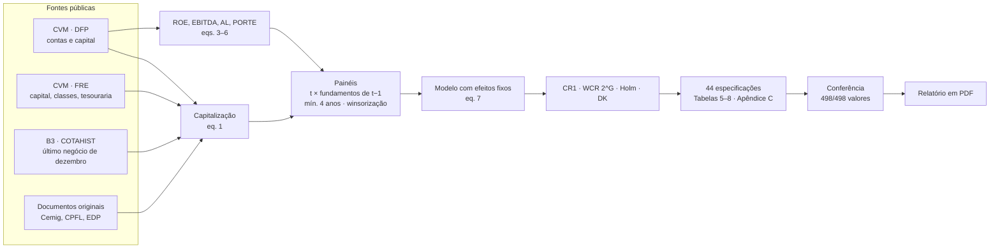

# Fundamentos contábeis e capitalização de mercado de empresas elétricas brasileiras

[](https://github.com/rodrigo-fontes/tcc-value-relevance-setor-eletrico/actions/workflows/reproducao.yml)
[](LICENSE)
[](LICENSE-docs.md)
[](python/)
[](R/)
[](docs/conferencia.md)

Pacote de reprodução do Trabalho de Conclusão de Curso de **Rodrigo Pereira Fontes**, com orientação do Prof. **Marco Antonio Alves de Souza Junior** (Esalq/USP). Especialização (MBA) em Finanças e Controladoria, USP/Esalq, 2026.

O repositório refaz, em **Python** e em **R**, todo o caminho entre os dados públicos da CVM e da B3 e cada número e cada tabela do TCC: 498 valores de tabelas e de texto, todos conferidos automaticamente.

### Em poucas palavras

**O que é.** O TCC investiga se três fundamentos contábeis do ano anterior acompanham o valor de mercado das empresas elétricas brasileiras em 2020–2025: rentabilidade (ROE), alavancagem líquida e porte. Pergunta também se essa relação se mantém quando mudam a forma de medir e o conjunto de empresas. O estudo se insere na literatura de relevância informacional, que associa números contábeis ao valor de mercado (Barth, Beaver e Landsman, 2001; Ohlson, 1995; Collins, Maydew e Weiss, 1997). No setor elétrico, dialoga com Souza, Ribeiro e Paulo (2024) e Leite et al. (2025).

**Por que os scripts existem.** Um resultado empírico só pode ser verificado se outra pessoa refizer o caminho dos dados até os números (Peng, 2011). Aqui, a maior parte desse caminho vem antes da regressão. Quantidades de ações em milhares, tesouraria já descontada, desdobramentos fora de época e lucro da controladora zerado alteram o resultado sem nenhuma mensagem de erro. Os scripts tornam cada uma dessas decisões explícita, executável e conferível.

**O que eles fazem.** Concilia preço e quantidade por classe de ação e calcula os fundamentos. Monta os painéis e estima o modelo com efeitos fixos de empresa e de ano. A inferência é feita com poucas empresas, por erro-padrão agrupado e *wild cluster bootstrap* com todas as 16.384 combinações (Cameron e Miller, 2015; Roodman et al., 2019). O modelo é reestimado em 43 variações. No fim, os scripts geram todas as tabelas do TCC e conferem cada número com o texto impresso.

**O que o TCC encontrou.** No modelo principal, +10 p.p. de ROE se associam a uma capitalização 6,16% **menor**, o que contraria H1. Mais alavancagem se associa a menos valor (−9,62% por vez de dívida/EBITDA; apoia H2), e mais porte, a mais valor (+5,04% para +10% de ativo; apoia H3). As verificações mostram que o sinal do ROE não é estável: perde significância com o patrimônio no modelo, com o ROA e sem a CEB, que concentra 54,55% da informação usada para estimá-lo. Alavancagem e porte recebem apoio parcial. A lição para a Controladoria é conferir período, escopo e eventos extraordinários antes de usar um indicador como base de avaliação.

➜ **Explicação completa e didática: [Guia do projeto](docs/guia_do_projeto.md).**

### Documentação

| Documento | Para que serve |
|---|---|
| [Guia do projeto](docs/guia_do_projeto.md) | **Comece aqui.** O que é o estudo, a literatura em que se apoia, por que os scripts existem, o que cada um faz e o que o TCC encontrou |
| [Decisões de projeto](docs/decisoes_de_projeto.md) | **Por que** cada escolha foi feita: o que se decidiu, a justificativa, a alternativa e onde ela foi testada (35 decisões de metodologia, dados e engenharia) |
| [Metodologia](docs/metodologia.md) | Equações, regras e correspondência entre o TCC e o código |
| [Casos de conciliação](docs/decisoes.md) | Cada empresa-ano em que uma regra ou um documento original mudou o dado |
| [Conferência](docs/conferencia.md) | Como os 498 valores e as listas do TCC são conferidos |
| [Referências](docs/referencias.md) | Referencial teórico e fontes de dados |
| [Relatório de reprodução (PDF)](docs/relatorio_reproducao.pdf) | Todas as tabelas do TCC, geradas pelo código e explicadas |

---

## Sumário

1. [O estudo em uma página](#1-o-estudo-em-uma-página)
2. [Duas implementações: Python e R](#2-duas-implementações-python-e-r)
3. [Como reproduzir](#3-como-reproduzir)
4. [Fluxo da análise](#4-fluxo-da-análise)
5. [Estrutura do repositório](#5-estrutura-do-repositório)
6. [Conferência dos resultados](#6-conferência-dos-resultados)
7. [Limitações](#7-limitações)
8. [Como citar e licença](#8-como-citar-e-licença)

---

## 1. O estudo em uma página

**Pergunta.** As associações entre fundamentos contábeis do exercício anterior e capitalização de mercado permaneceram estáveis diante de mudanças nos indicadores e nas empresas analisadas?

**Hipóteses.**

| | Associação esperada com a capitalização |
|---|---|
| **H1** | positiva com o retorno sobre o patrimônio líquido (ROE) |
| **H2** | negativa com a alavancagem líquida (dívida líquida / EBITDA) |
| **H3** | positiva com o porte (logaritmo do ativo total) |

**Dados.** Demonstrações Financeiras Padronizadas (DFP) e Formulário de Referência (FRE) da CVM, cotações históricas da B3 e documentos societários originais. Painel principal com **14 companhias e 76 observações anuais (2020–2025)**; extensão histórica com 15 companhias e 97 observações (2012–2025).

**Modelo** (eq. 7 do TCC): dados em painel com efeitos fixos de empresa e de ano e fundamentos do exercício anterior,

$$y_{it} = \alpha_i + \lambda_t + \beta_1\,\mathrm{ROE}_{i,t-1} + \beta_2\,\mathrm{AL}_{i,t-1} + \beta_3\,\mathrm{PORTE}_{i,t-1} + \varepsilon_{it}, \qquad y_{it} = \ln(\mathrm{VM}_{it}).$$

**Inferência.** Erro-padrão agrupado por empresa com correção de pequena amostra (CR1) e, como teste prioritário, *wild cluster restricted bootstrap* (WCR) com enumeração completa das 2¹⁴ = 16.384 combinações. Holm para as três hipóteses; Driscoll–Kraay como comparação suplementar.

**Resultados do modelo principal** (Tabelas 5 e 6 do TCC):

| Fundamento (t−1) | Coeficiente | Erro-padrão CR1 | p CR1 | p WCR | p Holm | Associação estimada |
|---|---:|---:|---:|---:|---:|---|
| ROE | −0,6354 | 0,1044 | < 0,0001 | 0,0026 | 0,0077 | +10 p.p. → −6,16% de capitalização |
| Alavancagem | −0,1011 | 0,0384 | 0,0208 | 0,0259 | 0,0259 | +1 vez → −9,62% |
| Porte | 0,5164 | 0,1934 | 0,0192 | 0,0061 | 0,0122 | +10% de ativo → +5,04% |

N = 76; G = 14; K = 22; R² intra-grupo = 0,2130; R² parcial de duas vias = 0,2896.

**Leitura.** No modelo principal, H1 foi contrariada (ROE maior associado a menor capitalização), e H2 e H3 receberam apoio. Nas 18 verificações da matriz de sensibilidade (Tabela 7), o ROE foi significativo pelo WCR em 12, a alavancagem em 13 e o porte em 15. A rentabilidade perdeu significância com ln(PL), com o ROA e sem a CEB, que concentra 54,55% da variação que identifica o coeficiente do ROE. Os resultados medem associação, não causalidade.

> Detalhes de cada etapa, com as equações e as referências: [docs/metodologia.md](docs/metodologia.md). Por que cada escolha foi feita, com a alternativa e onde ela foi testada: [docs/decisoes_de_projeto.md](docs/decisoes_de_projeto.md). Relatório completo gerado pelos scripts: [docs/relatorio_reproducao.pdf](docs/relatorio_reproducao.pdf).

---

## 2. Duas implementações: Python e R

| Pasta | Conteúdo | Dependências |
|---|---|---|
| [`python/`](python/) | pacote `tcc` em 11 módulos e `executar.py` | pandas, NumPy, SciPy, matplotlib; mínimos quadrados com indicadoras de empresa e ano em NumPy, conferidos com statsmodels (a biblioteca citada no TCC) e linearmodels |
| [`R/`](R/) | os mesmos 11 módulos em R e `executar.R` | só R base; fixest opcional, só na conferência |

As duas versões são independentes, comentadas linha a linha e citam no código o referencial teórico de cada etapa. Partem dos mesmos dados (`dados/`) e do mesmo roteiro de relatório (`relatorio/roteiro.txt`), e cada uma grava em sua própria pasta: `resultados/python/` e `resultados/r/`. O script `scripts/comparar_versoes.py` confirma que os resultados são idênticos (diferença máxima da ordem de 10⁻¹³).

---

## 3. Como reproduzir

Clone o repositório e rode, a partir da raiz:

```bash
git clone https://github.com/rodrigo-fontes/tcc-value-relevance-setor-eletrico.git
cd tcc-value-relevance-setor-eletrico

# Python (≥ 3.12)
pip install -r python/requirements.txt
python python/executar.py

# R (≥ 4.2) — ou abra R/executar.R no RStudio e clique em "Source"
Rscript R/executar.R

# Opcional: confere se Python e R deram o mesmo resultado
python scripts/comparar_versoes.py
```

| | Python | R |
|---|---|---|
| Tempo | ~12 s | ~14 s |
| Saídas | `resultados/python/` | `resultados/r/` |
| Relatório | `resultados/python/relatorio_reproducao.pdf` | `resultados/r/relatorio_reproducao.pdf` |

Nenhuma etapa acessa a internet. As cinco etapas são as mesmas nas duas linguagens:

| Etapa | O que faz | Seção do TCC |
|---|---|---|
| 1. Construir a base | Concilia quantidade de ações (DFP × FRE), tesouraria e preço da mesma classe; calcula a capitalização (eq. 1), os fundamentos (eqs. 3–6) e os painéis | Dados; Tabelas 1–3; Apêndices A e B |
| 2. Estimar | Modelo principal e mais 43 especificações; CR1, WCR, Holm, Driscoll–Kraay, R², VIF e concentração (FWL) | Tabelas 5–8; Apêndice C |
| 3. Tabelas | Gera todas as tabelas do TCC (1 a 8 e Apêndices A, B e C) e a Figura 1 | Resultados; Apêndices |
| 4. Conferir | Compara com o pacote original, com bibliotecas independentes e com os 498 valores do texto | Apêndice B |
| 5. Relatório | PDF de ~27 páginas, com cada etapa explicada | — |

---

## 4. Fluxo da análise



**Funil da amostra:** 23 emissoras × 6 anos = 138 combinações → 90 com capitalização conciliada → 84 com os três fundamentos → **76** com o mínimo de quatro exercícios por empresa.

---

## 5. Estrutura do repositório

```
├── README.md                     este arquivo
├── LICENSE                       MIT (código)
├── LICENSE-docs.md               CC BY 4.0 (texto e figuras)
├── CITATION.cff                  como citar
├── python/                       versão Python  → python/README.md
│   ├── executar.py               roda as cinco etapas
│   ├── requirements.txt
│   └── tcc/                      config, entradas, capitalizacao, contabil, painel, estimacao,
│                                 especificacoes, tabelas, valores, conferencia, relatorio
├── R/                            versão R  → R/README.md
│   ├── executar.R                roda as cinco etapas
│   └── *.R                       os mesmos 11 módulos
├── scripts/comparar_versoes.py   Python × R, arquivo a arquivo
├── dados/                        extratos congelados da coleta (entrada)  → dados/README.md
│   ├── cvm/                      DFP e FRE
│   ├── b3/                       último negócio de dezembro e manifesto de hashes
│   ├── documentos/               CPFL (6-K), caracterização das empresas, valores publicados no TCC
│   └── cvm_complementar/         DRE individual e extratos para aplicações financeiras
├── referencia/                   saídas do pacote original (só para conferência)
├── relatorio/roteiro.txt         texto do relatório em PDF (o mesmo nas duas linguagens)
├── coleta/                       scripts originais que baixaram os extratos complementares
├── docs/
│   ├── guia_do_projeto.md        explicação didática: o estudo, os scripts e os achados
│   ├── metodologia.md            equações, regras e correspondência código ↔ TCC
│   ├── decisoes_de_projeto.md    por que cada escolha foi feita (metodologia, dados, engenharia)
│   ├── decisoes.md               casos documentados de conciliação
│   ├── conferencia.md            como os resultados são conferidos
│   ├── referencias.md            referencial teórico e fontes
│   ├── relatorio_reproducao.pdf  relatório gerado pelos scripts
│   └── figura_1.png              Figura 1 do TCC
├── .github/workflows/            integração contínua: roda as duas versões e compara
└── resultados/                   gerado na execução (não versionado)
```

A cada envio ao GitHub, a integração contínua roda as duas versões, as três conferências e a comparação Python × R.

---

## 6. Conferência dos resultados

Cada execução termina com três conferências independentes ([docs/conferencia.md](docs/conferencia.md)):

| | Comparação | Resultado |
|---|---|---|
| A | Saídas × pacote original que gerou o TCC (37 modelos, 111 coeficientes) | Idênticas; contagens do bootstrap exatas |
| B | Fórmulas próprias × statsmodels e linearmodels (Python) ou fixest (R) | Diferença máxima de 10⁻¹⁰ |
| — | Versão Python × versão R (`scripts/comparar_versoes.py`) | 30 de 30 arquivos idênticos |
| C | Os 498 valores impressos no TCC, recalculados e formatados com as mesmas casas decimais; listas de empresas do Apêndice A | 498 de 498 |

---

## 7. Limitações

- A reprodução parte dos extratos preservados na coleta. A seleção do último negócio de dezembro nos arquivos brutos da B3 e a extração das contas da DFP foram feitas na coleta; os arquivos brutos com hash preservado são identificados por SHA-256 em `dados/fontes.json`, `dados/cvm_complementar/catalogo_*.json` e `dados/b3/manifesto_precos.json`.
- Usa-se a última versão de cada demonstração: a base incorpora reapresentações e não reproduz exatamente a informação disponível ao investidor em cada data.
- A listagem de 23 emissoras é documental e não é um censo das elétricas da B3. O pacote mostra que os números decorrem dos dados e das regras declaradas, mas não comprova que a listagem foi fixada antes da análise (TCC, Apêndice B).
- Os diagnósticos de concentração e as retiradas descrevem a sensibilidade dos resultados; não identificam efeito causal.

---

## 8. Como citar e licença

> FONTES, R. P.; SOUZA JUNIOR, M. A. A. **Fundamentos contábeis e capitalização de mercado de empresas elétricas brasileiras**. Trabalho de Conclusão de Curso (MBA em Finanças e Controladoria) — Escola Superior de Agricultura “Luiz de Queiroz”, Universidade de São Paulo, Piracicaba, 2026.

Metadados de citação em [CITATION.cff](CITATION.cff). O código está sob licença [MIT](LICENSE); textos, relatório e figuras, sob [CC BY 4.0](LICENSE-docs.md). Os dados de origem são públicos (CVM e B3) e continuam sujeitos às condições de uso das respectivas fontes.
