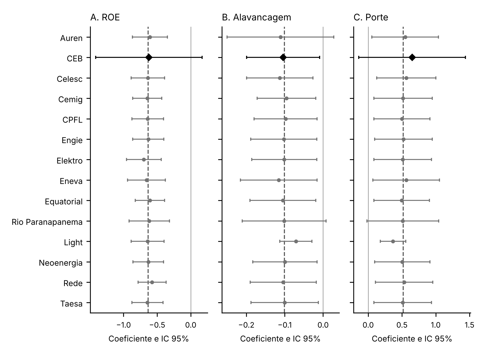

# Guia do projeto

Este guia explica o projeto do começo ao fim, para quem nunca leu o TCC:

- de que trata o estudo e em que literatura ele se apoia;
- por que os scripts foram escritos;
- o que cada um faz;
- o que o trabalho encontrou;
- como ler esses achados.

Os números citados são os do TCC e são recalculados pelo código a cada execução. As referências completas estão em [referencias.md](referencias.md).

## Sumário

1. [O projeto em poucas palavras](#1-o-projeto-em-poucas-palavras)
2. [A pergunta e de onde ela vem](#2-a-pergunta-e-de-onde-ela-vem)
3. [Como a pergunta foi respondida](#3-como-a-pergunta-foi-respondida)
4. [Por que os scripts existem](#4-por-que-os-scripts-existem)
5. [O que cada script faz](#5-o-que-cada-script-faz)
6. [O que o TCC encontrou](#6-o-que-o-tcc-encontrou)
7. [Como ler os achados](#7-como-ler-os-achados)
8. [Por onde começar](#8-por-onde-começar)

---

## 1. O projeto em poucas palavras

Analistas e controllers olham para lucro, dívida e tamanho de uma empresa quando tentam entender quanto ela vale. O TCC perguntou se, nas empresas elétricas brasileiras listadas na B3, esses três números do ano anterior acompanham o valor de mercado das ações, e se essa relação **se mantém** quando se muda a forma de medir ou o conjunto de empresas.

A resposta curta é que a relação existe no modelo principal, mas é menos estável do que parece. A parte que mais muda é justamente a do lucro.

Este repositório refaz o caminho inteiro, dos arquivos públicos da CVM e da B3 até cada número impresso no trabalho. Ele faz isso duas vezes, em Python e em R, e confere automaticamente os 498 valores do texto.

---

## 2. A pergunta e de onde ela vem

### Relevância informacional

A literatura de **relevância informacional** (*value relevance*) pergunta se os números da contabilidade se associam ao valor que o mercado atribui às empresas (Barth, Beaver e Landsman, 2001). Os trabalhos se apoiam em algumas bases:

- **Ohlson (1995)** formalizou a relação entre valor, patrimônio, lucro e dividendos.
- **Collins, Maydew e Weiss (1997)** mostraram que lucro e patrimônio contribuem de forma diferente, sobretudo quando há resultados extraordinários.
- **Easton e Harris (1991)** e **Kothari e Zimmerman (1995)** discutiram a diferença entre explicar o **valor** (nível de preço) e explicar o **retorno** (variação de preço).

O TCC trabalha com o valor: a capitalização de mercado, ou seja, quanto valem todas as ações da empresa juntas.

### O setor elétrico

Dois estudos recentes são os mais próximos:

- **Souza, Ribeiro e Paulo (2024)** compararam demonstrações societárias e regulatórias de 13 companhias elétricas em 2010–2021. O lucro foi mais relevante nas distribuidoras, e o patrimônio nas transmissoras.
- **Leite et al. (2025)** examinaram a qualidade da informação contábil em 317 companhias não financeiras, com um indicador de mercado relativo ao patrimônio.

### Por que 2020–2025

O período reuniu juros em alta, escassez hídrica e várias reorganizações empresariais: venda de distribuidoras, incorporações e recuperação judicial. Num ambiente assim, um mesmo indicador pode significar coisas diferentes de um ano para outro. Por isso o foco do trabalho é a **estabilidade** das associações, mais do que a existência delas.

### A pergunta e as hipóteses

A pergunta do TCC:

> "As associações entre fundamentos contábeis do exercício anterior e capitalização permaneceram estáveis diante de mudanças nos indicadores e nas empresas analisadas?"

As hipóteses seguem a leitura usual dos fundamentos (Penman, 2013):

| Hipótese | Fundamento | Sinal esperado | Intuição |
|---|---|---|---|
| H1 | Rentabilidade (ROE) | positivo | mais lucro sobre o capital próprio, mais valor |
| H2 | Alavancagem líquida (dívida líquida / EBITDA) | negativo | mais dívida em relação à geração operacional, mais risco |
| H3 | Porte (logaritmo do ativo total) | positivo | mais recursos, maior escala |

---

## 3. Como a pergunta foi respondida

### Os dados

- **Contabilidade:** Demonstrações Financeiras Padronizadas (DFP) e Formulário de Referência (FRE) da CVM.
- **Preços:** cotações históricas da B3.
- **Documentos das empresas:** usados quando a base pública não fechava.

Das 23 emissoras da listagem de trabalho, 14 tiveram dados conciliáveis em pelo menos quatro anos, o que resultou em **76 observações empresa-ano** em 2020–2025.

### Quatro escolhas que explicam o modelo

1. **Fundamentos do ano anterior.** O valor de dezembro de 2021 é comparado com o lucro, a dívida e o ativo de 2020. A razão é simples: em dezembro, o mercado ainda não conhecia as demonstrações daquele ano.
2. **Efeitos fixos de empresa e de ano.** O modelo compara cada empresa com ela mesma. Pergunta se a Cemig vale mais nos anos em que o ROE da Cemig está acima do padrão da Cemig, e não se a Cemig vale mais que a Taesa. Os efeitos de ano retiram o que é comum a todas as empresas num mesmo ano, como os juros (Wooldridge, 2019; Hsiao, 2022).
3. **Inferência com poucas empresas.** Os seis anos de uma mesma empresa não são seis informações independentes. O erro-padrão é agrupado por empresa (CR1) (Cameron e Miller, 2015). Com só 14 empresas, o teste prioritário é o *wild cluster restricted bootstrap* (WCR): ele refaz o modelo em todas as 16.384 combinações possíveis de sinais por empresa e conta quantas produzem uma estatística tão extrema quanto a observada (Cameron, Gelbach e Miller, 2008; Roodman et al., 2019; MacKinnon, Nielsen e Webb, 2023).
4. **Muitas verificações.** O mesmo modelo foi reestimado mais de 40 vezes, mudando uma coisa de cada vez: tirar uma empresa, trocar o ROE pelo ROA, incluir o patrimônio, usar o ano corrente, estender o período até 2012. Se a conclusão muda quando uma única empresa sai, ela não pode ser lida como regra geral.

As equações e as regras completas estão em [metodologia.md](metodologia.md). O porquê de cada escolha, com a alternativa testada, está em [decisoes_de_projeto.md](decisoes_de_projeto.md).

---

## 4. Por que os scripts existem

### Reprodutibilidade

Um resultado empírico só pode ser verificado se outra pessoa conseguir refazer o caminho dos dados até os números. A literatura chama isso de **reprodutibilidade** e a trata como requisito mínimo de credibilidade em pesquisa computacional e em economia (Peng, 2011; Christensen e Miguel, 2018; referências complementares, que não constam do TCC). O TCC registra que o material de reprodução preservou os dados selecionados e as decisões de inclusão, disponíveis mediante solicitação. Este repositório torna esse material público e executável.

### Os dados mudam o resultado sem avisar

Neste estudo, reproduzir não é só rodar uma regressão. Grande parte do trabalho está antes dela:

- **Escala.** Algumas empresas informam a quantidade de ações em milhares. Sem conferência, a capitalização fica mil vezes menor.
- **Tesouraria.** Às vezes a quantidade informada já desconta as ações em tesouraria. Descontar de novo subestima o valor.
- **Classes de ações.** Um desdobramento aprovado em janeiro aparece nas demonstrações de dezembro. Preço e quantidade deixam de corresponder.
- **Lucro da controladora.** Em alguns anos ele vem zerado na base da CVM, embora o lucro total esteja correto.

Nenhum desses problemas produz uma mensagem de erro: o número simplesmente sai errado. Os scripts registram cada regra aplicada e cada empresa-ano afetada, e excluem a observação quando a divergência não se resolve ([decisoes.md](decisoes.md)).

### Três provas

- **Com o pacote original:** os resultados são idênticos às saídas que geraram o TCC, inclusive as contagens exatas do bootstrap.
- **Com bibliotecas consolidadas:** as fórmulas escritas à mão (NumPy, R base) coincidem com statsmodels, linearmodels e fixest.
- **Com o texto impresso:** cada um dos 498 números do TCC é recalculado e formatado como no texto, com a vírgula, o "< 0,0001" e o asterisco, e comparado com o publicado.

### Duas linguagens

Python e R são implementações independentes. Se as duas chegam aos mesmos 30 arquivos de resultado, o achado não depende de um detalhe de software.

---

## 5. O que cada script faz

Os dois programas, `python/executar.py` e `R/executar.R`, rodam as mesmas cinco etapas. Cada etapa corresponde a módulos com o mesmo nome nas duas linguagens.

| Etapa | Módulos | Entra | Sai | No TCC |
|---|---|---|---|---|
| **1. Construir a base** | `entradas`, `capitalizacao`, `contabil`, `painel` | extratos da CVM e da B3, documentos das empresas | capitalização conciliada, fundamentos, painéis de 76 e 97 observações, decisão sobre cada empresa-ano | Dados; eqs. 1–6; Tabelas 1–3; Apêndices A e B |
| **2. Estimar** | `estimacao`, `especificacoes` | painéis | coeficientes, CR1, WCR, Holm, Driscoll–Kraay, R², VIF e concentração, para o modelo principal e 43 alternativas | eq. 7; Tabelas 5–8; Apêndice C |
| **3. Tabelas** | `tabelas` | resultados da etapa 2 | todas as tabelas do TCC em CSV e a Figura 1 | Tabelas 1–8; Apêndices A, B e C; Figura 1 |
| **4. Conferir** | `conferencia`, `valores` | resultados e valores publicados | "TUDO CONFERIDO" ou a lista de divergências | Apêndice B |
| **5. Relatório** | `relatorio` | resultados e `relatorio/roteiro.txt` | PDF de cerca de 30 páginas, com cada etapa explicada | — |

Os parâmetros do estudo (anos, percentis, mínimo de exercícios, tolerâncias) ficam em `config.py` / `config.R`, cada um com a seção do TCC de onde vem. Cada linha de código tem um comentário, e cada módulo cita no cabeçalho a literatura da etapa que implementa.

---

## 6. O que o TCC encontrou

### O modelo principal

| Fundamento | Coeficiente | p WCR | p Holm | Leitura (eq. 8) | Hipótese |
|---|---:|---:|---:|---|---|
| ROE | −0,6354 | 0,0026 | 0,0077 | +10 p.p. de ROE → capitalização 6,16% **menor** | H1 contrariada |
| Alavancagem | −0,1011 | 0,0259 | 0,0259 | +1 vez dívida/EBITDA → 9,62% menor | H2 apoiada |
| Porte | 0,5164 | 0,0061 | 0,0122 | +10% de ativo → 5,04% maior | H3 apoiada |

As três associações são significativas pelos dois testes, mesmo com o ajuste de Holm para três hipóteses. O sinal do ROE é o contrário do esperado.

### As verificações

**Rentabilidade (H1).** O sinal negativo perdeu sustentação nas verificações:

- Com o logaritmo do patrimônio no modelo, o ROE continua negativo, mas deixa de ser significativo pelo WCR (p = 0,2009).
- Trocando o ROE pelo ROA líquido ou pelo ROA operacional, também não há significância (p WCR = 0,3412 e 0,6285).
- Com a média de três anos de ROE, o coeficiente fica positivo e sem significância (p = 0,9613).
- No modelo com fundamentos do mesmo ano, também não há significância (p = 0,7988).

**O caso da CEB.** Uma só empresa concentra **54,55%** da variação que identifica o coeficiente do ROE, e só a observação de 2022 responde por **31,38%**. Em 2021, a CEB vendeu sua distribuidora: o lucro saltou e o ROE bruto foi de 63,74% para 150,84%. Sem a CEB, o coeficiente quase não muda (de −0,6354 para −0,6241), mas o erro-padrão sobe de 0,1044 para 0,3638, e o teste perde significância. A CEB afeta sobretudo a **precisão**. O TCC não a apresenta como explicação do sinal negativo.

A Figura 1 do TCC mostra isso de uma vez. Pontos: coeficiente estimado após retirar a empresa indicada; barras: intervalo CR1 de 95%; linha tracejada: modelo principal; losango: retirada da CEB. Retirar a CEB quase não move o ponto do ROE, mas alarga muito o intervalo, que passa a cruzar o zero. Retirar a Light desloca alavancagem e porte.

<em>Figura 1. Coeficientes após a retirada de cada empresa (TCC). Gerada por <code>tabelas.py</code> / <code>tabelas.R</code>.</em>

**Alavancagem (H2).** O sinal negativo é persistente:

- resiste à dívida ampliada, que desconta também as aplicações financeiras (p = 0,0262);
- resiste ao agrupamento por grupos societários (p = 0,0303);
- mas, em vários recortes, o p fica perto de 5%. Retirando só a Light, ou só a CEB, ele fica em 0,0598.

**Porte (H3).** A associação positiva permanece em várias versões. Enfraquece no painel balanceado (9 empresas, 54 observações) e no modelo com fundamentos do mesmo ano.

**Extensão histórica.** Com 2012–2025 (97 observações de 15 empresas), os três sinais e a significância permanecem. A ampliação acrescenta sobretudo as trajetórias de Cemig, CPFL e EDP; não cobre o setor de forma uniforme.

### A síntese do TCC

| Hipótese | Conclusão |
|---|---|
| H1 | Contrariada no modelo principal; a contradição **perde estabilidade** com patrimônio, outras medidas de rentabilidade e alinhamento contemporâneo |
| H2 | **Apoio parcial:** o sinal negativo resiste, mas a significância depende de empresas, recortes e datas |
| H3 | **Apoio parcial:** a associação positiva permanece em várias versões, mas enfraquece no painel balanceado e no modelo contemporâneo |

---

## 7. Como ler os achados

### Associação não é causa

Os coeficientes descrevem como valor e fundamentos se movem juntos dentro de cada empresa. Eles não dizem que aumentar o ROE reduz o valor. O TCC menciona mecanismos plausíveis para o sinal negativo, como lucros transitórios, distribuições e expectativas, mas não os identifica.

### A lição para a Controladoria

Nas palavras do TCC:

> "Para a Controladoria, a comparação exigiu um critério prático: conferir período e escopo, distinguir lucro recorrente e eventos extraordinários, reconciliar distribuições e patrimônio e registrar mudanças de atividades antes de interpretar um indicador. Quando a conclusão mudou com essa conferência ou com a retirada de uma empresa, o coeficiente não fundamentou isoladamente uma regra de avaliação."

### Os limites

- A listagem de 23 emissoras não é um censo do setor.
- As demonstrações usadas incorporam reapresentações posteriores.
- Com 14 empresas, a inferência tem pouca margem.
- As verificações são exploratórias e não devem ser contadas como confirmações independentes.

O README e a [metodologia](metodologia.md) detalham esses pontos.

---

## 8. Por onde começar

| Se você quer… | Comece por |
|---|---|
| ver os resultados sem rodar nada | [relatorio_reproducao.pdf](relatorio_reproducao.pdf) |
| rodar tudo | o [README](../README.md), seção "Como reproduzir" |
| entender uma equação ou uma regra | [metodologia.md](metodologia.md) |
| saber por que algo foi feito assim | [decisoes_de_projeto.md](decisoes_de_projeto.md) |
| ver um caso concreto (Cemig 2020, Light, CPFL…) | [decisoes.md](decisoes.md) |
| entender como os números são conferidos | [conferencia.md](conferencia.md) |
| ler o código | `python/tcc/config.py` ou `R/config.R`, depois os módulos na ordem da tabela da seção 5 |
